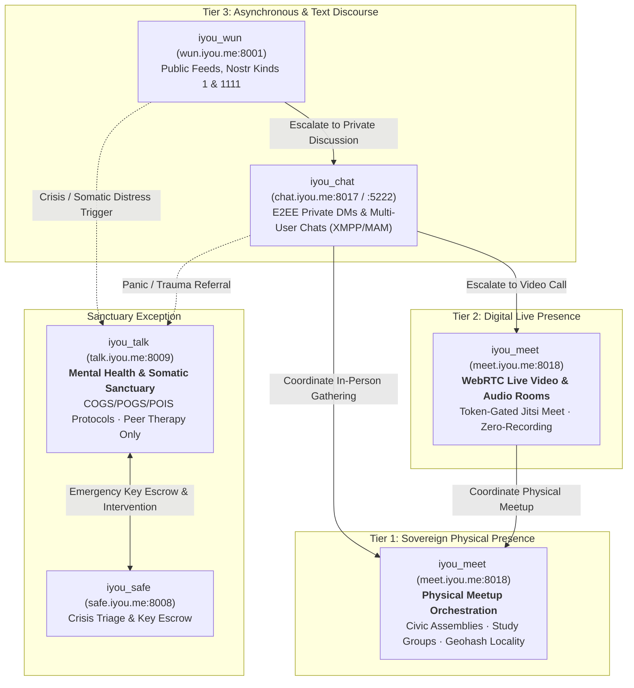

# Canonical Communication Escalation Specification

**Specification Identifier:** `OMNI-COMM-ESCALATION-V1`  
**Hub:** `omni_social`  
**Path:** `docs/specs/COMMUNICATION_ESCALATION_SPEC.md`  
**Status:** Living Canonical Standard  
**Published:** 2026-11-15  
**Target Implementers:** `iyou_wun`, `iyou_chat`, `iyou_meet`, `iyou_talk`, `iyou_safe`, `iyou_home`, `iyou_idp`  
**Companion Specifications:**  
- `docs/specs/CANONICAL_GEOGRAPHIC_ROUTING_SPEC.md` (Geohash & Locality Bounding)  
- `docs/OMNI_SOCIAL_PROTOCOL_V2.md` (Port & Protocol Architecture)  
- `docs/PROJECT_ZERO_SPEC.md` (Port 9001 Cryptographic Bridge)  
- `docs/specs/CREATOR_ECOSYSTEM_SPEC.md` (Creator & Media Segmentation)  
- `docs/strategy/PROTOCOL_INTEGRITY_AND_POST_MORTEM_GOVERNANCE.md` (Sovereignty Invariants)  

---

## 1. System Vision & Escalation Philosophy

### 1.1 The Hazard of Flat Communication Architectures
Centralized communication networks flatten human interaction into undifferentiated streams. Platforms either force all interaction into noisy, surveillance-heavy video silos (e.g., Zoom, Google Meet) or expose users to unvetted private contact without progressive consent gates. Furthermore, they conflate general social chatter, professional discourse, crisis support, and embodied physical meetings onto the same unsegmented telemetry engines.

In the Omni-Social sovereign mesh, human connection is governed by the **Principle of Progressive Consensual Presence**:
1. Interactions begin with minimal vulnerability, low bandwidth, and low cognitive demand.
2. Escalation toward real-time voice, video, or embodied physical presence requires explicit, bilateral cryptographic consent and distinct satellite trust boundaries.
3. Specialized psychological sanctuaries are structurally separated from general civic and social hubs to guarantee unimpeachable confidentiality and safety.



---

## 2. The 3-Tier Escalation Ladder

| Tier | Presence Dimension | Primary Satellites | Underlying Wire Protocols | Typical Trust Gate |
| :--- | :--- | :--- | :--- | :--- |
| **Tier 3** | **Text & Asynchronous** | `iyou_wun`, `iyou_chat` | Nostr (NIP-01/10/65), XMPP/OMEMO (MAM Archive), MLS | Pseudonymous DID / npub; Web-of-Trust discovery |
| **Tier 2** | **Digital Live Presence** | `iyou_meet` | WebRTC (Jitsi Meet API), Ephemeral STUN/TURN | Token-gated room signed by DID or verified OIDC session |
| **Tier 1** | **Physical Embodied Presence** | `iyou_meet` | Geohash Locality Index, Nostr Kind 31923/31924 Events | Proximity verification, locality attestation, mutual consent |
| **Sanctuary** | **Clinical & Somatic Therapy** | `iyou_talk` | P2P Encrypted WebRTC, Signal Double Ratchet, Jitsi | Verified peer-counselor attestation, COGS/POGS credentials |

---

### 2.1 Tier 3: Text & Asynchronous Discourse (`iyou_wun` & `iyou_chat`)

- **`iyou_wun` (The Agora):**
  - Public discourse, broadcast microblogging, and threaded deliberation.
  - Powered by Nostr event streams (`Kind 1` short notes, `Kind 1111` threaded comments, `Kind 30023` long-form).
  - Open discovery without biometric, location, or synchronous availability expectations.
- **`iyou_chat` (The Sovereign Salon):**
  - 1-on-1 direct messages and private multi-user chats (MUCs).
  - Powered by Prosody XMPP daemon with MAM (Message Archiving Management) and OMEMO end-to-end encryption.
  - Acts as the conversational staging ground where participants determine whether an interaction merits escalation to voice/video or in-person connection.

---

### 2.2 Tier 2: Digital Live Presence (`iyou_meet` Video)

- **Purpose:** Synchronous, low-latency audiovisual interaction for meetings, webinars, study sessions, and social calls.
- **Engine Architecture:**
  - Embedded Jitsi Meet WebRTC library operating in a lightweight, sovereign Django wrapper.
  - Ephemeral room allocations: Room identifiers are generated dynamically using high-entropy hashes:  
    $$\text{room\_id} = \text{SHA-256}(\text{initiator\_did} \parallel \text{recipient\_did} \parallel \text{timestamp})[:16]$$
- **Access Gating & Capabilities:**
  - No open, unprotected URLs. Rooms require a signed JWT or Schnorr BIP-340 capability signature verified against `iyou_home` (Port 9001 bridge) or `iyou_idp`.
- **Zero-Surveillance Invariants:**
  - **Zero Server-Side Recording:** Satellite servers never write video or audio streams to disk.
  - **Zero Behavioral Analytics:** No attendee attention tracking, gaze tracking, or speech-to-text transcript harvesting.
  - **Ephemerality:** When the last participant disconnects, room context and in-memory caches are immediately destroyed.

---

### 2.3 Tier 1: Sovereign Physical Presence (`iyou_meet` Rendezvous)

- **Purpose:** Transitioning digital relationships into sovereign, real-world community organizing, neighborhood potlucks, civic town halls, study circles, and mutual aid actions.
- **Locality & Privacy Engine:**
  - Built upon `CANONICAL_GEOGRAPHIC_ROUTING_SPEC.md`. Meetups resolve to structured hierarchical subdomains:  
    `{locality}.{state}.{country}.meet.iyou.me` (e.g., `dkc.il.us.meet.iyou.me`).
  - **Coarse Geohash Anchoring:** Public meetup coordinates are rounded to Geohash precision levels 4–5 ($\approx 2.4\text{km} - 20\text{km}$) or pinned to designated public third-spaces (libraries, community centers, municipal parks, public transit concourses).
  - **Anti-Doxxing Invariant:** Under no condition does `iyou_meet` publish or query precise residential coordinates or raw GPS breadcrumbs.
- **Proof-of-Rendezvous (Optional):**
  - Attendees may exchange peer Bluetooth/BLE or local QR Nostr attestations to verify attendance without central registry reporting.

---

## 3. The Sanctuary Exception: `iyou_talk` Isolation

### 3.1 Structural Purpose of `iyou_talk`
`iyou_talk` (`talk.iyou.me`, Port `8009`) is **not** a general social video app or casual chatroom. It is an isolated psychological and somatic sanctuary purpose-built for:
1. **Crisis Triage & De-escalation:** Immediate, confidential support for individuals experiencing acute psychological distress.
2. **Somatic & Trauma Support:** Modalities requiring grounded, trauma-informed presence (somatic experiencing, grief witnessing).
3. **Structured Clinical/Peer Growth Frameworks:**
   - **COGS:** Continuous Observational Growth Sessions.
   - **POGS:** Peer-Observed Growth Sanctuaries.
   - **POIS:** Psychological Observation & Intervention Safeguards.

### 3.2 The Non-Contamination Rule (The Talk Firewall)
To preserve emotional safety and therapeutic boundaries:
> [!IMPORTANT]
> **The Talk Firewall Invariant:**
> Casual social gatherings, business meetings, civic debates, entertainment watch-parties, and creator fan interactions are **strictly prohibited** from executing on `iyou_talk`. All non-therapeutic video and meetup activities MUST be routed exclusively to `iyou_meet`.

### 3.3 Protective Guardrails on `iyou_talk`
- **Zero Discovery Index:** Rooms and counselor rosters on `iyou_talk` are never listed in public search indexes or `_ecosystem_bar.html` general drawers.
- **Panic Bridge Integration:** Hardwired panic and key escrow protocols link directly to `iyou_safe` (`safe.iyou.me`), enabling rapid authorized guardian notification upon explicit client distress triggers.
- **Strictest E2EE Mandate:** Sessions utilize end-to-end encryption with ephemeral forward secrecy; no logs, diagnostics, or observer connections are permitted without cryptographic consent from all room participants.

---

## 4. Cross-Satellite Escalation Wire Contracts

### 4.1 Chat-to-Video Escalation Protocol (`iyou_chat` → `iyou_meet`)
When participants in an `iyou_chat` conversation (direct message or MUC) elect to escalate to video:

1. **Initiation:** The caller triggers the `/meet` slash command or taps the video escalation icon.
2. **Payload Generation:** `iyou_chat` requests an ephemeral meeting token from `iyou_meet`:
   ```json
   {
     "action": "CREATE_MEET_TOKEN",
     "channel_id": "xmpp:council@muc.chat.iyou.me",
     "initiator_did": "did:key:z6MkhaXgBZs...",
     "participants": [
       "did:key:z6MkhaXgBZs...",
       "did:key:z6MknG18m53..."
     ],
     "valid_duration_seconds": 1800
   }
   ```
3. **Interactive Card Dispatch:** An escalation invitation component (`_meet_escalation_card.html`) renders directly within the chat message stream with a one-click transition button:
   ```html
   <div class="meet-escalation-pill flex items-center gap-2 p-2 rounded-lg bg-emerald-50 dark:bg-emerald-950/40 border border-emerald-300">
     <span>📹 Live Video Escalation</span>
     <a href="https://meet.iyou.me/r/e8a9f3b1#token=eyJhbG..." target="_blank" class="px-2 py-1 rounded bg-emerald-600 text-white font-bold text-xs">
       Join Sovereign Room ↗
     </a>
   </div>
   ```

### 4.2 Public Event-to-Rendezvous Escalation (`iyou_wun` → `iyou_meet`)
When a public discussion on `iyou_wun` produces a planned gathering:
- Organizers publish a Nostr `Kind 31923` (Date-Based Event) or `Kind 31924` (Time-Based Event) tagging:
  - `["g", "<geohash>"]` for coarse geographic localization.
  - `["streaming", "https://meet.iyou.me/r/<room_id>"]` for hybrid or virtual participants.
  - `["location", "Auditorium B, Oak Park Public Library, Oak Park, IL"]` for physical attendees.
- `iyou_wun` renders the event card with deep-links directly into `meet.iyou.me` for RSVP and room entry.

### 4.3 Crisis & Sanctuary Referral (`iyou_wun` / `iyou_chat` → `iyou_talk`)
When automated distress patterns or manual help triggers are engaged:
- The UI renders the non-judgmental **Sanctuary Bridge**:
  ```html
  <a href="https://talk.iyou.me/sanctuary?intent=peer_support" class="bg-cyan-600 hover:bg-cyan-500 text-white font-bold px-3 py-1.5 rounded-lg text-xs">
    Enter Peer Sanctuary (iyou_talk) 🕊️
  </a>
  ```
- All contextual chat tokens are stripped; the user enters `iyou_talk` with complete architectural isolation and zero tracking residue.

---

## 5. Network Topology & Port Mapping

| Service / Satellite | Domain | Port | Protocol | Architectural Role in Escalation Ladder |
| :--- | :--- | :--- | :--- | :--- |
| **`iyou_wun`** | `wun.iyou.me` | `8001` | HTTP/WS | Tier 3 Agora: Public discourse & event definition |
| **`iyou_talk`** | `talk.iyou.me` | `8009` | HTTP/WebRTC | **Sanctuary Exception:** Clinical/peer therapy & somatic regulation |
| **`iyou_baba`** | `baba.iyou.me` | `8016` | HTTP | Sovereign sticker & media reaction foundry |
| **`iyou_chat`** | `chat.iyou.me` | `8017` | HTTP/WS | Tier 3 Salon: E2EE direct messaging & group MUCs |
| **`iyou_meet`** | `meet.iyou.me` | `8018` | HTTP/WebRTC | **Tier 1 & 2 Hub:** Live video rooms & physical rendezvous |
| **`iyou_dine`** | `dine.iyou.me` | `8028` | HTTP | Physical restaurant OS & hospitality settlement |
| **`iyou_show`** | `show.iyou.me` | `8029` | HTTP | Zero-custody creator video channel indexing |
| **`iyou_muse`** | `muse.iyou.me` | `8030` | HTTP | Exhibition gallery for visual artifacts |
| **`iyou_hear`** | `hear.iyou.me` | `8031` | HTTP | Sovereign audio & value-for-value stream routing |
| **Prosody XMPP** | `chat.iyou.me` | `5222` | TCP/WSS | XMPP message transport for `iyou_chat` |
| **Signature Bridge** | `home.iyou.me` | `9001` | WSS | Local cryptographic key attestation & token signing |

---

## 6. Implementation Checklist for `iyou_meet`

- [x] Register `iyou_meet` in `scripts/generate_templates.py` (`ECOSYSTEM_APPS`, `APP_STATUS`, `APP_COLORS`, `APP_DESCRIPTORS`, `APP_MISSIONS`).
- [x] Register `iyou_meet` in `scripts/regenerate_all.py` (`APPS` dictionary with `"flat"` layout).
- [x] Register `iyou_meet` in `scripts/sync_ecosystem_specs.py` (`TARGET_REPOS` and `SPEC_FILES`).
- [x] Register `COMMUNICATION_ESCALATION_SPEC.md` in `docs/specs/` and `docs/satellite-coordination.md`.
- [x] Update 26-App Roster across `AGENT.md`, `docs/OMNI_SOCIAL_DEVELOPER_GUIDE.md`, and `docs/OMNI_SOCIAL_PROTOCOL_V2.md`.
- [x] Verify template generation and specification propagation with `--dry-run`.
