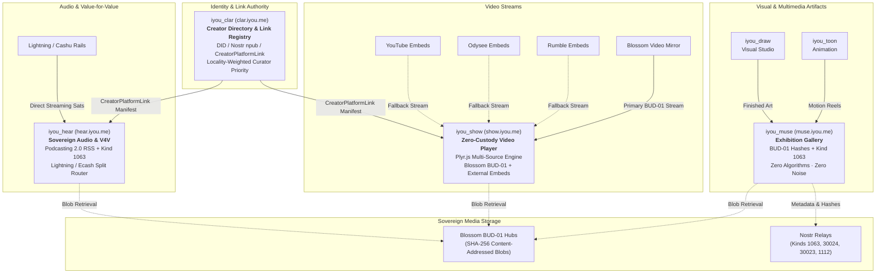
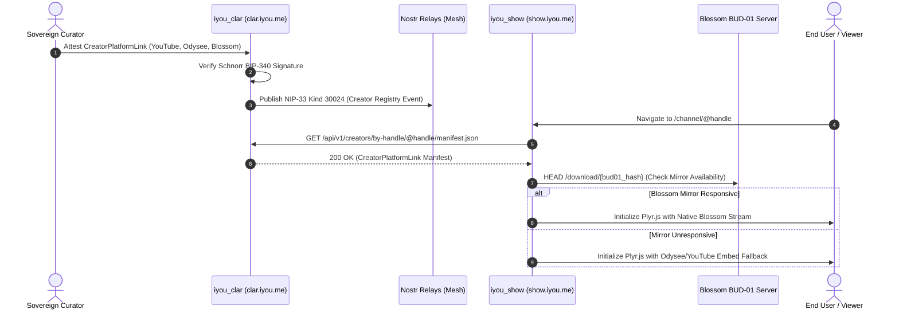
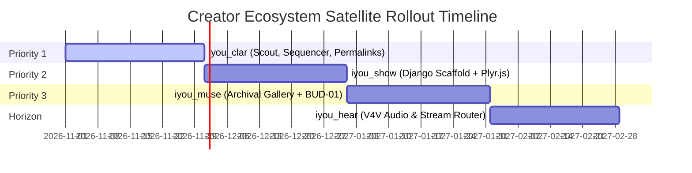

# Canonical Creator Ecosystem Architecture Specification

**Specification Identifier:** `OMNI-CREATOR-SPEC-V1`  
**Hub:** `omni_social`  
**Status:** Living Canonical Standard  
**Published:** 2026-11-13  
**Target Implementers:** `iyou_clar`, `iyou_muse`, `iyou_show`, `iyou_hear`, `iyou_draw`, `iyou_home`, `iyou_idp`  
**Cross-References:** `OMNI-DEP-GRAD-SPEC-V1` (Dependent Identity), `OMNI_SOCIAL_PEER_FEDERATION_SPEC.md` (Blossom & Nostr Wire), `PROJECT_ZERO_SPEC.md` (Port 9001 Bridge)

---

## 1. System Vision & The Anti-Silo Paradigm

### 1.1 The Failure of Web2 Monolithic Media Silos
Centralized media platforms (YouTube, Spotify, Instagram, Vimeo, SoundCloud) bundle four fundamentally orthogonal layers into proprietary walled gardens:
1. **Identity & Authority:** Creator profiles, usernames, follower graphs, and verification badges are locked inside platform databases, subject to arbitrary deplatforming or algorithmic demotion.
2. **Binary Custody & Transcoding:** Platforms mandate raw media upload, re-encode files with lossy compression, inject digital rights restrictions, and control distribution bandwidth.
3. **Monetization & Stream Extraction:** Platforms extract 30–50% take-rates on ads, memberships, and superchats, while denying creators direct peer-to-peer micro-settlement.
4. **Behavioral Conditioning (The Engagement Engine):** Hyper-optimized recommendation algorithms and comment flamewars hijack user attention, punish contemplative or non-sensationalist creative works, and force creators onto a grueling treadmill of engagement-maximizing content.

### 1.2 The Omni-Social Decoupled Architecture
The Omni-Social Creator Ecosystem dismantles this monopoly by establishing a **strict four-tier separation of concerns**:
- **Identity & Authority Tier (`iyou_clar`):** Sovereign directory, platform registry, and cryptographic curator priority sequencing.
- **Visual & Multimedia Artifact Exhibition Tier (`iyou_muse`):** Attribution-first, museum-grade exhibition gallery for finished visual art, photography, animation, and choreographic showcases.
- **Video Channel Indexer & Multi-Source Stream Tier (`iyou_show`):** Zero-custody channel indexer and client-side multi-source player unifying sovereign Blossom mirrors with external embeds.
- **Audio & Value-for-Value Stream Tier (`iyou_hear`):** Sovereign audio/music/podcast aggregator and lightning/ecash stream router.



### 1.3 Normative Language
The key words **MUST**, **MUST NOT**, **REQUIRED**, **SHALL**, **SHALL NOT**, **SHOULD**, **SHOULD NOT**, **RECOMMENDED**, **MAY**, and **OPTIONAL** in this document are to be interpreted as described in [RFC 2119](https://www.ietf.org/rfc/rfc2119.txt).

---

## 2. §1 Separation of Concerns: Creator vs. Artifact vs. Stream

The core architectural invariant of `OMNI-CREATOR-SPEC-V1` is the strict decoupling of **Creator**, **Artifact**, and **Stream**. Satellites **MUST NOT** cross these domain boundaries.

```
┌──────────────────────────────────────────────────────────────────────────────┐
│                              OMNI MESH ENTITIES                              │
├───────────────────┬───────────────────────────────┬──────────────────────────┤
│ DOMAIN            │ PRIMARY RESPONSIBILITY        │ CANONICAL SATELLITE      │
├───────────────────┼───────────────────────────────┼──────────────────────────┤
│ CREATOR           │ Universal identity, handle,   │ iyou_clar                │
│                   │ platform links, curator rank  │ (clar.iyou.me)           │
├───────────────────┼───────────────────────────────┼──────────────────────────┤
│ ARTIFACT          │ Finished high-res artwork,    │ iyou_muse                │
│                   │ visual reels, exhibition,     │ (muse.iyou.me)           │
│                   │ BUD-01 hash, attribution card │                          │
├───────────────────┼───────────────────────────────┼──────────────────────────┤
│ VIDEO STREAM      │ Video indexer, multi-source   │ iyou_show                │
│                   │ Plyr.js player, mirror/embed  │ (show.iyou.me)           │
│                   │ failover, zero transcoding    │                          │
├───────────────────┼───────────────────────────────┼──────────────────────────┤
│ AUDIO / V4V       │ Music, podcasts, stems, V4V   │ iyou_hear                │
│                   │ streaming micro-settlement    │ (hear.iyou.me)           │
└───────────────────┴───────────────────────────────┴──────────────────────────┘
```

### 2.1 `iyou_clar` (`clar.iyou.me`) — Universal Creator Directory & Attestation Ledger

`iyou_clar` is the single source of truth for **creator identity**, **cross-platform presence**, and **curator priority consensus**.

#### Architectural Boundaries
- **Canonical Responsibilities:**
  1. **Universal Directory Indexing:** Maintains canonical records of creators across every medium (music, film, animation, visual arts, photography, dance, literature, investigative journalism, cultural commentary).
  2. **Multi-Platform Link Registry (`CreatorPlatformLink`):** Aggregates and maintains verified cross-platform links (YouTube, Odysee, Rumble, PeerTube, Spotify, Bandcamp, SoundCloud, Nostr, Blossom, Substack, GitHub).
  3. **Cryptographic Identity Claim & Anchoring:** Bridges Web2 handles to decentralized identifiers (`did:key`, Nostr `npub`) via Schnorr BIP-340 verification challenges (`POST /creator/<id>/claim/nostr/`).
  4. **Multi-Tier Locality & Sentiment Priority:** Implements cryptographic curator voting (`CuratorVote`) with geographic scoping (`vote_country`, `vote_state`, `vote_locality`) and priority sequencing.
  5. **Taxonomy & Consensus Tags:** Structures creator topics into a 3-tier hierarchy (`PILLAR` $\rightarrow$ `SUBGENRE` $\rightarrow$ `NICHE`) with a 3-curator consensus threshold (`Creator.get_consensus_tags(threshold=3)`).
  6. **Public Curator Permalinks:** Exposes human-readable curator and creator pages (`/@handle`, `/@handle/manifest.json`).

- **Strict Prohibitions:**
  - `iyou_clar` **MUST NOT** store or serve video, audio, or large image binary blobs.
  - `iyou_clar` **MUST NOT** embed video or audio playback engines in its directory views (it exposes metadata and links to `iyou_show`, `iyou_muse`, and `iyou_hear`).
  - `iyou_clar` **MUST NOT** perform algorithmic feed generation or real-time engagement telemetry.

### 2.2 `iyou_muse` (`muse.iyou.me`) — Attribution-First Public Exhibition Gallery

`iyou_muse` is an attribution-first digital museum and public exhibition gallery for **finished visual and multimedia artifacts**.

#### Architectural Boundaries
- **Canonical Responsibilities:**
  1. **Finished Artifact Exhibition:** Curates and displays completed digital paintings, vector illustrations, mixed-media collages (authored in `iyou_draw`), 2D/3D motion graphics and character animations (from `iyou_toon`), fine art photography, and recorded dance/movement showcases.
  2. **Blossom Content Addressability:** Every exhibited piece **MUST** resolve to a cryptographic SHA-256 hash hosted across peer Blossom (`BUD-01`) nodes.
  3. **Nostr Kind `1063` Integration:** Exhibition metadata, dimensions, color profiles, medium descriptors, and licensing are declared using Nostr Kind `1063` (File Metadata Event) standards.
  4. **Cryptographic Attribution Cards:** Displays immutable provenance linking directly to the creator's DID, Nostr pubkey, and `iyou_clar` directory entry.
  5. **Museum-Grade UI:** High-fidelity canvas rendering, ultra-high-resolution pan-and-zoom inspection, neutral white/dark studio lighting, and typography inspired by archival exhibition catalogs.

- **The Zero-Algorithm & Anti-Noise Invariant:**
  - `iyou_muse` **MUST NOT** implement algorithmic recommendations, trending feeds, popularity heatmaps, or endless scrolling doom-loops. All gallery views are curated, chronological, or taxonomy-filtered.
  - `iyou_muse` **MUST NOT** include comment sections, reply threads, or social commentary widgets. Artifacts speak for themselves; feedback occurs through direct peer-to-peer sovereign messaging (`iyou_chat`) or curated critical monographs.

### 2.3 `iyou_show` (`show.iyou.me`) — Zero-Custody Video Channel Indexer & Multi-Source Player

`iyou_show` is a distraction-free, zero-custody video channel indexer and multi-source web player.

#### Architectural Boundaries
- **Canonical Responsibilities:**
  1. **Zero-Custody Architecture:** `iyou_show` never stores video payloads and performs zero server-side transcoding. All video data originates either from sovereign Blossom `BUD-01` mirrors or external platforms.
  2. **Channel Indexing:** Ingests creator video channels using `CreatorPlatformLink` manifests from `iyou_clar`, mapping video entries across both sovereign and legacy platforms.
  3. **Multi-Source Player Engine (`Plyr.js`):** Embeds a clean, customizable HTML5 `Plyr.js` player that seamlessly unifies:
     - Direct content-addressed Blossom video files (`.mp4`, `.webm`, HLS manifests).
     - External video embeds (YouTube, Odysee/LBRY, Rumble, PeerTube).
  4. **Client-Side Failover Cascade:** The player attempts to stream from Blossom `BUD-01` mirrors first. If mirror latency exceeds timeout thresholds or if a mirror is unavailable, the player automatically falls back to the external platform embed without user intervention.
  5. **Sovereign Channel Discovery:** Organizes videos strictly by Creator Channel, Series, Playlist, or Curated Collection.

- **Strict Prohibitions:**
  - `iyou_show` **MUST NOT** require video transcoding infrastructure (FFmpeg worker queues, S3 video buckets).
  - `iyou_show` **MUST NOT** display third-party behavioral ads, overlay banners, or algorithmic "up next" autoplay recommendations that pull viewers into algorithmic rabbit holes.

### 2.4 `iyou_hear` (`hear.iyou.me`) — Sovereign Audio Aggregator & Value-for-Value Router

`iyou_hear` is a sovereign audio, music, stem, and podcast player with native Value-for-Value streaming.

#### Architectural Boundaries
- **Canonical Responsibilities:**
  1. **Audio Aggregation:** Aggregates music releases, podcast episodes, audiobooks, and sound design stems linked in `iyou_clar`.
  2. **Podcasting 2.0 & Nostr Wire Support:** Ingests RSS feeds compliant with Podcasting 2.0 tags (`<podcast:value>`, `<podcast:live>`, `<podcast:chapters>`) and Nostr audio events (`kind:30023` long-form audio, `kind:1063` audio blobs).
  3. **Value-for-Value (V4V) Stream Router:** Seamlessly routes per-minute or boostagram streaming micro-payments via Lightning (LUD-06 / LUD-16 LNURL) and ecash (Cashu tokens) directly to creator wallets and designated collaborator split trees.
  4. **Continuous Background Playback:** Provides a lightweight persistent audio player chassis across the mesh.

- **Strict Prohibitions:**
  - `iyou_hear` **MUST NOT** take custody of payments or hold funds in platform escrow. Payment splits are routed directly to recipient keys.

---

## 3. §2 Cross-Satellite Data Contracts

### 3.1 The Canonical Role of `iyou_clar`
`iyou_clar` serves as the centralized identity registry and multi-platform manifest provider for the mesh. Downstream satellites (`iyou_show`, `iyou_muse`, `iyou_hear`) consume `iyou_clar` manifests using two standardized interfaces:
1. **Synchronous HTTP/REST API:** Fast metadata lookups and JSON manifests.
2. **Asynchronous Nostr Events (Kind 30024 & Kind 1063):** Decentralized, relay-backed publish/subscribe synchronization.



### 3.2 Canonical Manifest Schema: `CreatorPlatformLink`
`iyou_clar` exports the canonical `CreatorPlatformLink` manifest as structured JSON:

```json
{
  "$schema": "https://specs.iyou.me/schemas/creator-platform-link-v1.json",
  "version": "1.0.0",
  "creator": {
    "id": "550e8400-e29b-41d4-a716-446655440000",
    "handle": "elena_dance",
    "canonical_name": "Elena Rostova",
    "did": "did:key:z6MkhaXgBZDvotDkL5257faiztiGiC2QtKLGpbnnEGta2doK",
    "nostr_pubkey": "3bf0c63fcb93463407af97b5e0903dcc3cedb50a4d429cb7381d30528f374f3c",
    "is_verified": true,
    "avatar": {
      "blossom_sha256": "e3b0c44298fc1c149afbf4c8996fb92427ae41e4649b934ca495991b7852b855",
      "fallback_url": "https://cdn.iyou.me/avatars/elena.jpg"
    },
    "taxonomy": {
      "pillar": "Arts & Performance",
      "subgenre": "Contemporary Dance",
      "consensus_tags": ["choreography", "improvisation", "motion-study"]
    }
  },
  "platforms": [
    {
      "platform_slug": "blossom_mirror",
      "stream_type": "video",
      "is_primary": true,
      "is_verified": true,
      "url": "https://blossom.iyou.me/download/b94d27b9934d3e08a52e52d7da7dabfac484efe37a5380ee9088f7ace2efcde9",
      "handle_display": "blossom://b94d27...cde9",
      "metadata": {
        "mime_type": "video/mp4",
        "sha256": "b94d27b9934d3e08a52e52d7da7dabfac484efe37a5380ee9088f7ace2efcde9",
        "resolution": "1920x1080",
        "duration_seconds": 412
      }
    },
    {
      "platform_slug": "odysee",
      "stream_type": "video",
      "is_primary": false,
      "is_verified": true,
      "url": "https://odysee.com/@ElenaDance:a/winter-solstice:4",
      "handle_display": "@ElenaDance",
      "metadata": {
        "claim_id": "a1b2c3d4e5f6071829",
        "embed_url": "https://odysee.com/$/embed/@ElenaDance:a/winter-solstice:4"
      }
    },
    {
      "platform_slug": "youtube",
      "stream_type": "video",
      "is_primary": false,
      "is_verified": true,
      "url": "https://www.youtube.com/watch?v=dQw4w9WgXcQ",
      "handle_display": "@ElenaRostovaDance",
      "metadata": {
        "video_id": "dQw4w9WgXcQ"
      }
    },
    {
      "platform_slug": "bandcamp",
      "stream_type": "audio",
      "is_primary": true,
      "is_verified": true,
      "url": "https://elenadance.bandcamp.com/album/resonance",
      "handle_display": "elenadance"
    }
  ],
  "curation": {
    "consensus_priority_score": 98.4,
    "total_attested_curators": 14,
    "top_locality": "us/il/chicago"
  }
}
```

### 3.3 Nostr Wire Events Integration

#### Nostr Kind `30024`: Parameterized Replaceable Creator Registry
`iyou_clar` serializes creator records to Nostr relays under NIP-33 parameterized replaceable events:
- **`kind`:** `30024`
- **`pubkey`:** Curator or directory registry authority hex key
- **`d` tag:** Creator UUID or unique handle identifier (`["d", "creator:<uuid>"]`)
- **`c` tag:** Canonical category / pillar
- **`p` tag:** Claimed creator Nostr pubkey
- **`link` tag:** Platform link tuple: `["link", "<platform_slug>", "<url>", "<is_primary>"]`
- **`blossom` tag:** Content-addressed media hash: `["blossom", "<sha256>", "<mime>"]`

#### Nostr Kind `1063`: Content-Addressed File Metadata
`iyou_muse` and `iyou_show` ingest and broadcast media artifacts formatted under NIP-94 (Kind `1063`):
```json
{
  "kind": 1063,
  "pubkey": "3bf0c63fcb93463407af97b5e0903dcc3cedb50a4d429cb7381d30528f374f3c",
  "created_at": 1774185600,
  "tags": [
    ["url", "https://blossom.iyou.me/download/b94d27b9934d3e08a52e52d7da7dabfac484efe37a5380ee9088f7ace2efcde9"],
    ["m", "video/mp4"],
    ["x", "b94d27b9934d3e08a52e52d7da7dabfac484efe37a5380ee9088f7ace2efcde9"],
    ["ox", "b94d27b9934d3e08a52e52d7da7dabfac484efe37a5380ee9088f7ace2efcde9"],
    ["size", "148392019"],
    ["dim", "1920x1080"],
    ["summary", "Winter Solstice - Choreography in DeKalb"],
    ["t", "dance"],
    ["t", "performance"],
    ["i", "clar:550e8400-e29b-41d4-a716-446655440000"]
  ],
  "content": "Solo contemporary piece filmed at the Ellwood House Studio."
}
```

---

## 4. §3 Safety & Governance Invariants

### 4.1 Inherited `dep.bracket` Youth Ring-Fencing (`OMNI-DEP-GRAD-SPEC-V1`)
Minors in the Omni-Social mesh participate through parent-stewarded dependent identities as specified in `OMNI-DEP-GRAD-SPEC-V1`. All creator ecosystem satellites **MUST** inherit and enforce youth ring-fencing rules based on the user's OIDC `dep.bracket` token claim.

```
       OIDC Session Token (dep.bracket)
                     │
         ┌───────────┴───────────┐
         ▼                       ▼
    [ U14 Minor ]           [ U14_U18 Teen ]
         │                       │
         ├───────────────────────┼───────────────────────┐
         ▼                       ▼                       ▼
   [ Discovery ]           [ Interstitial ]        [ Outbound ]
  Strict Whitelist        External Gatekeeper      No Cleartext PII
  No Algorithmic Feeds    Warning Modal on         No Commenting
  No Unvetted Media       YouTube/Rumble Links     WoT Distance ≤ 1
```

#### Discovery Filtering Matrix
| Satellite | `dep.bracket == U14` | `dep.bracket == U14_U18` | `dep.bracket == ADULT` |
|:---|:---|:---|:---|
| **`iyou_muse`** | **Strictly Curated Whitelist:** Only artifacts explicitly tagged `child_safe:true` and approved by parent circle or verified curator consensus are visible. Uncurated search disabled. | **Standard Curated Gallery:** All artistic exhibitions visible, excluding artifacts flagged with content warnings (`fric:content_warning`). | **Full Access:** Unrestricted catalog access. |
| **`iyou_show`** | **Walled Garden Index:** Only channels attested with `safety_tier: "all_ages"` by $\ge 3$ distinct curators can be indexed or played. External embeds strictly sandboxed. | **Safe Discovery:** Videos with explicit adult or violence warnings filtered out. Interstitial warning prompt displayed before opening any external YouTube/Rumble link. | **Full Access:** Unrestricted video indexing and playback. |
| **`iyou_clar`** | **Read-Only Directory:** Directory viewing permitted; curator voting and public creator claim signing disabled. | **Supervised Voting:** Curator voting enabled within local school/community locality scope. | **Full Access:** Unrestricted directory, link attestation, and curator voting. |

#### Client-Side Interstitial Warning Rule
When a dependent (`U14` or `U14_U18`) clicks an external third-party link (e.g., `youtube.com`, `odysee.com`, `rumble.com`) inside `iyou_show` or `iyou_clar`, the satellite chassis **MUST NOT** perform immediate navigation. It **MUST** trigger an interstitial modal requiring explicit acknowledgement:
> *"You are leaving the Sovereign Mesh to visit an external third-party platform. External platforms may track your identity and expose uncurated algorithms."*

### 4.2 Zero-Custody Storage Rule
The Omni-Social Creator Ecosystem enforces a strict **Zero-Custody Storage Rule**:
1. **No Relational Custody:** Application databases (PostgreSQL, SQLite) **MUST NOT** store user media files, raw video streams, or large visual assets. The database stores **only metadata**: SHA-256 hashes, content descriptors, MIME types, resolutions, durations, URLs, and cryptographic signatures.
2. **Content Addressability:** All primary media blobs reside on content-addressed Blossom (`BUD-01`) storage servers and IPFS clusters.
3. **Resilience & Zero Data Loss:** If any satellite database is wiped or destroyed, the entire catalog and gallery state **MUST** be fully reconstructible by replaying Nostr Kind `1063` and Kind `30024` events from public relays against content-addressed Blossom nodes.

---

## 5. §4 Phased Satellite Rollout Order

To ensure architectural cohesion and prevent satellite drift, implementation is divided into four strictly ordered phases.



### 5.1 Priority 1: `iyou_clar` (`clar.iyou.me`) — Foundations First
`iyou_clar` is the keystone. No downstream player or gallery can function cleanly without the canonical directory and link registry.

#### Implementation Deliverables
1. **Smart Creator Scout:** Automated crawler and scraper service that validates external channel URLs (YouTube, Odysee, Rumble, Bandcamp), checks link health, extracts avatar images, and proposes new creator entries for curator attestation.
2. **Priority Sequencer:** Cryptographic curator voting engine with multi-tier geographic locality weighting (`vote_country`, `vote_state`, `vote_locality`), rank ordering algorithms, and Schnorr signature enforcement.
3. **Public Curator Permalinks:** Human-readable permalinks (`/@handle`, `/@handle/manifest.json`), NIP-05 Nostr identity endpoints (`/.well-known/nostr.json`), and NIP-33 Kind `30024` broadcast hooks.
4. **`CreatorPlatformLink` Manifest API:** RESTful JSON endpoint (`GET /api/v1/creators/<id>/manifest.json` and `GET /api/v1/creators/by-handle/<handle>/manifest.json`) compliant with §3.2.

#### Acceptance Criteria
- [ ] `GET /@handle/manifest.json` returns valid JSON conforming to §3.2.
- [ ] Schnorr BIP-340 verification passes in pure Python on creator claim endpoints.
- [ ] Consensus tags require $\ge 3$ distinct curator attestations before promotion.
- [ ] Locality-weighted sorting accurately ranks creators within geographic scopes.

### 5.2 Priority 2: `iyou_show` (`show.iyou.me`) — Zero-Custody Video Player
Once `iyou_clar` serves canonical manifests, `iyou_show` connects viewers to video channels without hosting infrastructure.

#### Implementation Deliverables
1. **Lightweight Django Satellite Scaffolding:**
   - Django 6.1 chassis with Secretless PKCE OIDC authentication (`auth_pkce.py`).
   - Standard 4-layer UI chassis (Layer 0 Ecosystem Bar, Layer 1 Header, Layer 2 Content, Layer 3 Footer).
   - Port 8029, domain `show.iyou.me`, color `red` / `rose`.
2. **Plyr.js Multi-Source Player Integration:**
   - Bundled, locally-vendored `plyr.min.js` and `plyr.min.css` (no CDN dependencies).
   - Unified player interface supporting HTML5 direct video (`video/mp4`, `video/webm`) and iframe embeds (YouTube, Odysee, Rumble).
3. **Blossom Mirror Failover Engine:**
   - Client-side pre-flight check for Blossom `BUD-01` mirrors.
   - Automatic fallback to external embeds when mirrors are unresponsive.
4. **Channel & Series Layout:**
   - Creator channel view (`/@handle`), video detail view (`/v/<uuid>`), and playlist drawer.
   - `dep.bracket` youth ring-fencing on all discovery lists and external link warnings.

#### Acceptance Criteria
- [ ] Plyr.js initializes cleanly with zero console errors across desktop and mobile.
- [ ] Blossom video playback succeeds on valid `BUD-01` hashes.
- [ ] Unreachable Blossom mirrors seamlessly fail over to YouTube/Odysee embeds.
- [ ] `dep.bracket == U14` accounts cannot view unverified external links.

### 5.3 Priority 3: `iyou_muse` (`muse.iyou.me`) — Artifact Exhibition Gallery
With video and identity operational, `iyou_muse` provides the sanctuary for visual and multimedia fine art.

#### Implementation Deliverables
1. **Exhibition Chassis & Canvas Viewer:**
   - Responsive, distraction-free exhibition gallery.
   - Zoomable high-resolution inspection canvas supporting ultra-wide digital paintings, vector art, and high-DPI scans.
   - Dark studio / gallery lighting modes with pure-CSS theme toggle.
2. **Blossom & Kind `1063` Ingestion Pipeline:**
   - Ingests visual artifacts directly from `iyou_draw` export webhooks and Nostr Kind `1063` events.
   - Validates SHA-256 hashes against Blossom nodes before adding pieces to public exhibitions.
3. **Archival Provenance & Attribution Cards:**
   - Displays creator name, handle, DID, medium, dimensions, date of creation, and parent `iyou_clar` link.
   - Displays digital signature verification badge.
4. **Anti-Algorithm Invariant Verification:**
   - Verification suite asserting zero infinite scrolls, zero recommendation weights, and zero comment threads in template outputs.

#### Acceptance Criteria
- [ ] High-resolution images resolve exclusively to Blossom `BUD-01` SHA-256 URLs.
- [ ] Visual art authored in `iyou_draw` imports with intact provenance and attribution metadata.
- [ ] Exhibition views load strictly by curator collection, chronological timeline, or taxonomy tag.
- [ ] Zero comment input forms or discussion scripts exist anywhere in the templates.

### 5.4 Horizon: `iyou_hear` (`hear.iyou.me`) — Sovereign Audio & V4V Routing
The final phase activates the sovereign audio mesh, completing the multi-medium federation.

#### Implementation Deliverables
1. Podcasting 2.0 XML/RSS feed parser with `<podcast:value>` tag parsing.
2. Value-for-Value Lightning and ecash micro-settlement stream router.
3. Persistent background audio player docking into Layer 0/1 header slots.

---

## 6. Conformance & Test Vectors

Any satellite implementing `OMNI-CREATOR-SPEC-V1` **MUST** pass the following conformance test vectors.

### 6.1 Test Vector 1: `CreatorPlatformLink` Validation
A consumer satellite MUST parse and validate the canonical manifest against the JSON schema:
- **Input:** JSON payload defined in §3.2.
- **Assertion:**
  - `manifest["creator"]["id"]` is a valid RFC 4122 UUID.
  - `manifest["creator"]["did"]` starts with `did:key:`.
  - Every entry in `manifest["platforms"]` contains a valid `platform_slug` and `url`.
  - At least one platform link is marked `is_primary: true`.

### 6.2 Test Vector 2: Multi-Source Video Fallback Resolution
Given a video record with both a Blossom mirror and an external Odysee embed:
```python
def resolve_playback_source(record, blossom_probe_success: bool) -> dict:
    if blossom_probe_success and "blossom_mirror" in record["mirrors"]:
        return {
            "type": "video/mp4",
            "src": record["mirrors"]["blossom_mirror"]["url"],
            "provider": "html5",
        }
    return {
        "type": "embed",
        "src": record["external_embeds"]["odysee"]["embed_url"],
        "provider": "odysee",
    }
```
- **Assertion:** When `blossom_probe_success` is `True`, provider is `html5`. When `False`, provider is `odysee`. Zero uncaught exceptions.

### 6.3 Test Vector 3: Blossom `BUD-01` Kind `1063` Integrity Check
Given a Kind `1063` event:
- **Input:**
  - `tag 'x'`: `b94d27b9934d3e08a52e52d7da7dabfac484efe37a5380ee9088f7ace2efcde9`
  - `tag 'url'`: `https://blossom.iyou.me/download/b94d27b9934d3e08a52e52d7da7dabfac484efe37a5380ee9088f7ace2efcde9`
- **Assertion:** The SHA-256 hash of the downloaded payload matches `tag 'x'` exactly. If the hash mismatches, the payload **MUST** be immediately discarded with `BLOSSOM_INTEGRITY_MISMATCH`.

### 6.4 Test Vector 4: `dep.bracket` Discovery Ring-Fencing
Given an authenticated user session:
- **Input:** `request.user.claims["dep.bracket"] = "U14"`.
- **Assertion:**
  - `iyou_muse` gallery view filters `queryset.filter(is_child_safe=True)`.
  - `iyou_show` video view filters `queryset.filter(safety_tier="all_ages")`.
  - All external non-mesh links render with `class="dep-interstitial-guard"`.

---

## 7. Summary & Satellite Coordination Index

The following table summarizes the satellite responsibilities established by `OMNI-CREATOR-SPEC-V1`:

| Satellite | Domain | Role | Tech Stack | Storage / Data Strategy |
|:---|:---|:---|:---|:---|
| **`iyou_clar`** | `clar.iyou.me` | Creator Directory & Link Registry | Django 6.1 / Python 3.12 | PostgreSQL metadata + Nostr Kind `30024` |
| **`iyou_muse`** | `muse.iyou.me` | Archival Exhibition Gallery | Django 6.1 / Tailwind CSS | Blossom `BUD-01` + Nostr Kind `1063` |
| **`iyou_show`** | `show.iyou.me` | Zero-Custody Video Player | Django 6.1 / Plyr.js | Blossom `BUD-01` + External Embeds |
| **`iyou_hear`** | `hear.iyou.me` | Sovereign Audio & V4V Router | Django 6.1 / Lightning Rails | Podcasting 2.0 RSS + Kind `1063` |
| **`iyou_draw`** | `draw.iyou.me` | Visual Studio (Artifact Source) | Canvas / WebGL / Django | Exports directly to Blossom `BUD-01` |
